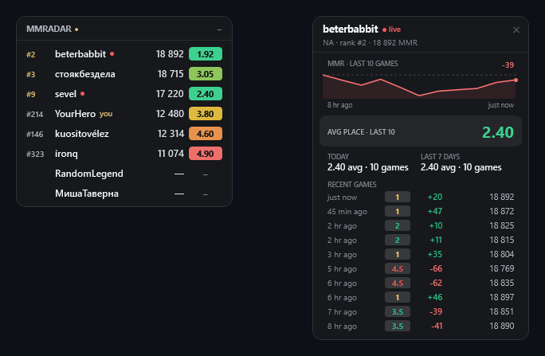

# MMRadar

A small Windows app for **Hearthstone Battlegrounds** that puts your whole lobby on the radar. It shows the leaderboard rating and average placement of every player at the table, and one click opens a full dossier on any of them: recent games, MMR trajectory and current form, powered by [wallii.gg](https://www.wallii.gg/).

**No Hearthstone Deck Tracker needed.** MMRadar runs on its own from the system tray and draws its panel over the game. It started as an HDT plugin, and the plugin is still available (see [HDT plugin](#hdt-plugin)).



## Features

- 🏆 **Lobby overview**: every player's rating and a color-coded **7-day average placement**, sorted by rating in either direction (highest or lowest on top). The header shows the **lobby average and your delta** to it; streamers get a live dot, and players who are out of the game grey out.
- 📈 **The whole ladder covered**: wallii-tracked top players get full stats; everyone else on the official leaderboard still shows their rating; confirmed sub-cutoff players show **<8 000**.
- 🔍 **Player dossier on click**: the **last 30 games** (estimated placement, MMR delta, resulting MMR) in a slim scrolling list, averages over those games / today / the last 7 days, and an MMR chart over the same games.
- 🔤 **Readable at a glance**: big high-contrast type with tabular digits, a card that hugs its content, and automatic scaling to the game's resolution that also accounts for Windows display scaling. The mouse wheel over the header zooms, and the text stays crisp at any size.
- 🎨 **Themes and avg colors**: **Dark**, **Neutral** (default) and **Warm** themes; the avg column can be **Classic** bright chips, **Tint** quiet chips, or plain colored **Text**.
- 🤝 **Duos and spectating**: teammates are grouped into pairs, and spectated games show the full lobby.
- 🫥 **Stays out of your way**: collapse the panel into a small, dim pill that is still easy to find; the panel appears only in Battlegrounds and hides with the game.
- 🧪 **Test panel**: show a demo lobby (the current world top 8) to place and size the panel before you play.
- 🔄 **Updates in one click**: MMRadar checks GitHub for new versions, verifies the download and restarts itself, keeping your settings.

## Install

1. Download `MMRadar-v<version>.zip` from [Releases](../../releases/latest).
2. **Extract** it into any folder (for example `Documents\MMRadar`). Do not run it from inside the zip.
3. Run `MMRadar.exe`. The first time, Windows may show "Windows protected your PC" because the app is not code-signed: click **More info**, then **Run anyway**.
4. MMRadar lives in the **system tray**, next to the clock. If Windows hides the icon behind **^**, drag it onto the taskbar. Click the icon to open MMRadar.
5. Click **Show test panel** to place and size the panel, then start Hearthstone. The panel appears by itself in every Battlegrounds match.

Requirements: Windows 10 or 11 (64-bit), .NET Framework 4.8 (built into Windows 10 1903+ and Windows 11).

### Moving from the HDT plugin

Remove `MMRadar.dll` from `%AppData%\HearthstoneDeckTracker\Plugins` (or disable the plugin in HDT), otherwise you will see two panels. On its first run the app copies the plugin's settings (position, scale, theme, colors), so the panel shows up where it was.

## Usage

- **Click a player row** to open their dossier. Click another row to switch, or ✕ to close it. Drag the dossier by its header to move it.
- **⚙ in the panel header** opens the settings right on the overlay, so the game never loses focus. The same settings are in the MMRadar window (tray icon).
- **–** collapses the panel into a pill; click the pill to expand it, drag to move it. The mouse wheel over the header zooms the panel; **Reset position** brings back the default spot and automatic size.
- The **tray menu** opens the window, shows or hides the panel, turns the overlay off, and exits the app. Closing the window keeps MMRadar running in the tray.
- The window also has **Start with Windows** and **Check for updates automatically**.

## Troubleshooting

- **"Hearthstone is running as administrator"**: MMRadar cannot read a game started with elevated rights. Start Hearthstone (and Battle.net) normally.
- **"Can't read this Hearthstone version"**: a game patch changed something MMRadar relies on. Check for an update in the MMRadar window; a fix usually follows the patch.
- **Antivirus warning**: MMRadar reads the game's memory to find the players in your lobby, which some antivirus tools flag. It only reads, never writes, and goes online only to look up players and to check GitHub for updates.
- Settings and logs live in `%AppData%\MMRadar` (the **Data folder** link in the window opens it).

### Uninstall

Uncheck **Start with Windows**, choose **Exit** in the tray menu, then delete the folder. To remove the settings too, delete `%AppData%\MMRadar`.

## How it works

- **Lobby players** come straight from the game: MMRadar reads Hearthstone's own memory (read-only) with a vendored copy of [UnitySpy](https://github.com/hackf5/unityspy) (MIT), the same technique deck trackers use. Nothing is injected into the game.
- **Stats** come from wallii.gg's public Supabase REST API, the same backend their website queries from the browser. wallii tracks the very top of the ladder, so detailed dossiers are available for those players.
- **Ratings for everyone else** come from the full official leaderboard via [BGrank's public mirror](https://github.com/IBM5100o/BGrank_bot) (one cached request per region), with a fallback to a [GitHub-hosted mirror](https://github.com/lowerman/bg-board-mirror). When both sources know a player, the fresher official rating wins, and names are matched case-exactly. Honest limitations:
  - players **below the official cutoff** (roughly 8000 MMR) show as "<8 000" and count toward the lobby average as 8 000;
  - per-game **placements are estimates** inferred from MMR changes (wallii's published formula), not exact Blizzard data.
- Requests are batched and cached to keep the load on wallii minimal. MMRadar never scrapes the wallii website.

If wallii ever rotates their public API key, override it in `%AppData%\MMRadar\settings.xml` (`WalliiBaseUrl`, `WalliiAnonKey`).

## HDT plugin

MMRadar started as a [Hearthstone Deck Tracker](https://hsreplay.net/downloads/) plugin, and it still works for people who prefer HDT. The last plugin release is **[v1.0.10](../../releases/tag/v1.0.10)**:

1. Download `MMRadar-v1.0.10.zip` and put the `MMRadar.dll` from it into `%AppData%\HearthstoneDeckTracker\Plugins`.
2. Restart HDT and enable the plugin: **Options → Tracker → Plugins → MMRadar**.

If Windows blocks the DLL, right-click it → Properties → check **Unblock**. Use either the plugin or the app, not both at once.

## Building from source

Prerequisites: [.NET SDK](https://dotnet.microsoft.com/download) 6+.

```powershell
tools\build-app.ps1         # the app: src\MMRadar.App\bin\Release\MMRadar.exe
tools\build-app.ps1 -Zip    # plus the release zip
```

The plugin needs an installed Hearthstone Deck Tracker for its assembly references:

```powershell
tools\build.ps1     # auto-detects your HDT install
tools\deploy.ps1    # build + copy the DLL into HDT's Plugins folder
```

`src/MMRadar.Harness` is a WPF test bed that renders the plugin's overlay without HDT or Hearthstone (`--top` for the live world top 8, `--live name1,name2 --region EU` for specific players, `--shot out.png` for a screenshot).

## Credits

- **[wallii.gg](https://www.wallii.gg/)** by JimLiu0 & the Wall_Lii team ([wall-lii-app](https://github.com/JimLiu0/wall-lii-app), [Wall_Lii](https://github.com/HS-Tools/Wall_Lii)): leaderboard data and the placement-estimation formula MMRadar re-implements. MMRadar is an unofficial community project and is not affiliated with wallii.
- **[HDT_BGrank](https://github.com/IBM5100o/HDT_BGrank)** by IBM5100: the original "opponent MMR overlay" idea, and the [BGrank_bot](https://github.com/IBM5100o/BGrank_bot) full-leaderboard mirror used for sub-top ratings.
- **[UnitySpy](https://github.com/hackf5/unityspy)** by brian t (MIT), via the [Zero-to-Heroes .NET Framework port](https://github.com/Zero-to-Heroes/unity-spy-.net4.5): the Unity memory reader the app is built on.
- **[Hearthstone Deck Tracker](https://github.com/HearthSim/Hearthstone-Deck-Tracker)** by HearthSim.

Not affiliated with Blizzard Entertainment. Hearthstone is a trademark of Blizzard Entertainment, Inc.

## License

[MIT](LICENSE)
